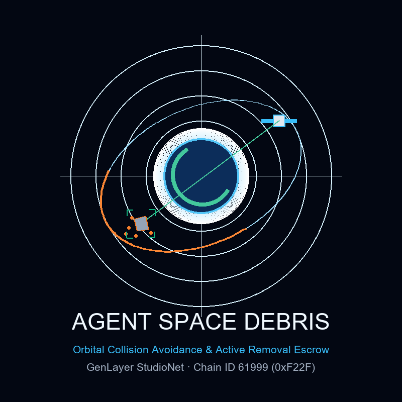

# 🛰️ AgentSpaceDebris (Autonomous Orbital Collision Avoidance & Active Space Debris Removal Escrow)

[](https://agentspacedebris.vercel.app)
[](https://studio.genlayer.com)
[-10B981?style=for-the-badge)](https://studio.genlayer.com/api)
[]()
[]()
[](LICENSE)

<p align="center">
  
</p>

> **AgentSpaceDebris** is an autonomous orbital sustainability and collision avoidance protocol deployed on **GenLayer StudioNet**. It bridges space situational awareness (SSA) radar networks, satellite telemetry, and Two-Line Element (TLE) ephemeris directly into smart contracts to enforce mathematically verified orbital debris de-orbiting into Earth's atmosphere.

---

## 🌌 1. The Problem Space: The Kessler Syndrome

Low Earth Orbit (LEO) is experiencing exponential congestion from over 36,000 tracked space debris fragments larger than 10 cm and millions of untracked hypervelocity projectiles. A runaway cascade of collisions—the **Kessler Syndrome**—threatens critical civilian telecommunications, navigation (GPS/Galileo), and Earth observation satellites.

### The Critical Market Deadlock
Commercial LEO constellation operators (e.g., Starlink, OneWeb) and space agencies want to hire Active Debris Removal (ADR) contractors (e.g., Astroscale, ClearSpace) to rendezvous with, grapple, and de-orbit defunct rocket bodies. However:
1. **Operator Escrow Risk:** Constellation operators fear fake de-orbit claims where ADR contractors collect multi-million dollar fees without actually altering the object's hazardous orbit.
2. **Contractor Non-Payment Fear:** ADR companies risk expending millions of dollars launching servicing chaser spacecraft, only for constellation operators to arbitrarily withhold final payment.
3. **EVM Incompetence:** Traditional Solidity smart contracts cannot read or parse Two-Line Element sets (TLEs) or execute orbital mechanics equations to verify whether an object has decayed below the 120 km atmospheric reentry threshold.

---

## 💡 2. The GenLayer Solution

**AgentSpaceDebris** deploys an **Intelligent Contract** on GenLayer StudioNet that arbitrates production telemetry via on-chain AI consensus:

```
+-----------------------------------------------------------------------------------------------+
|                                    AGENTSPACEDEBRIS                                           |
+-----------------------------------------------------------------------------------------------+
| 1. Constellation Operator locks GEN bounty escrow (create_removal_escrow)                     |
| 2. ADR Contractor submits radar ephemeris tracking (submit_orbital_telemetry)                 |
| 3. On-chain AI Astrodynamics Jury fetches radar feeds via gl.nondet.web.render                 |
| 4. Tri-Vector semantic consensus validates perigee decay & reentry status via gl.vm.run_nondet|
| 5. Automated Decision Matrix:                                                                 |
|    * DEORBIT_CONFIRMED_FULL: Perigee <= 120 km or Reentered -> 100% Bounty Disbursed          |
|    * PARTIAL_ORBIT_LOWERING: Altitude Decay >= 150 km -> 40% Fuel Milestone Disbursed         |
|    * REMOVAL_FAILED_REJECTED: Debris remains in orbit -> 100% Refunded to Operator            |
+-----------------------------------------------------------------------------------------------+
```

---

## 🚀 3. Deployed Contract Information (GenLayer StudioNet)

The intelligent contract is compiled, validated, and confirmed by validator consensus on GenLayer StudioNet:

| Parameter | Value |
|---|---|
| **Target Network** | **GenLayer StudioNet** |
| **Chain ID** | `61999` (Hex: `0xF22F`) |
| **RPC Endpoint** | `https://studio.genlayer.com/api` |
| **Contract Address** | `0xf7908283868BE5BE9ac235F74F900F906FA92F10` |
| **Deployment Transaction** | `0x13d18c31367756a8b306f460e40fa99b98b1c00bbfef4ce9629a7cdd549688da` |
| **Consensus Receipt Status** | `5` (`ACCEPTED` / `FINALIZED`) |
| **Live Production dApp** | [https://agentspacedebris.vercel.app](https://agentspacedebris.vercel.app) |
| **Studio Explorer** | [https://studio.genlayer.com](https://studio.genlayer.com) |

---

## 👥 4. Role-Based Access Control Specification

| Role | Entity | Authorized On-Chain Actions |
|---|---|---|
| `OPERATOR` | Constellation Sponsor / Agency | `create_removal_escrow`, `adjudicate_debris_deorbit`, `appeal_verdict`, `finalize_settlement`, `cancel_or_reclaim` |
| `CONTRACTOR` | Active Debris Removal (ADR) Servicer | `submit_orbital_telemetry`, `adjudicate_debris_deorbit`, `appeal_verdict`, `finalize_settlement` |
| `APPELLANT` | Bond Staker in Active Dispute | Staked 10% bond; receives bond refund if appeal is upheld |
| `OWNER` | Contract Deployer | Platform health checks, fallback settlement facilitation |
| `OBSERVER` | Public / Academic Spectator | View-only queries (`get_policy`, `get_all_policies`, `get_stats`, radar blips) |

---

## 🧠 5. Tri-Vector AI Astrodynamics Consensus Matrix

When `adjudicate_debris_deorbit` is triggered on-chain, GenLayer validators compute three distinct astrodynamics vectors:

1. **Vector A (Orbital Decay Magnitude):**
   Calculates total altitude reduction achieved ($\Delta h = h_{\text{initial}} - h_{\text{final}}$) and verifies apogee/perigee drop rates.
2. **Vector B (Reentry Interface Boundary):**
   Verifies whether the target space object has entered the dense mesosphere ($h_p \le 120\text{ km}$) or confirmed total atmospheric disintegration.
3. **Vector C (Kessler Mitigation Index):**
   Computes a 0–100 spatial risk mitigation score evaluating the reduction of spatial conjunction probability ($P_c$) with operational mega-constellations.

---

## 🏛️ 6. Decision Matrix & Escrow Settlement

| Verdict | Astrodynamics Criteria | On-Chain Action |
|---|---|---|
| `DEORBIT_CONFIRMED_FULL` | Measured Perigee $\le 120\text{ km}$ **OR** Status confirmed `DECAYED`/`REENTERED` | **100% of escrowed bounty disbursed** to ADR contractor. |
| `PARTIAL_ORBIT_LOWERING` | Altitude decay $\ge 150\text{ km}$ **BUT** Perigee remains $> 120\text{ km}$ | **40% fuel milestone disbursed**; 60% preserved for final decay. |
| `REMOVAL_FAILED_REJECTED` | Altitude decay $< 150\text{ km}$ **AND** Perigee $> 120\text{ km}$ (failed rendezvous) | **Bounty revoked**; 100% refunded to constellation operator. |
| `STATUS_UNRESOLVED` | Radar feed unreachable, canary mismatch, or malformed JSON | **Non-settling safety lock**; escrow protected from erroneous payout. |

---

## 🛡️ 7. Security Engineering

1. **Accredited Space Tracker Whitelist (`ACCREDITED_SPACE_TRACKERS`):**
   Telemetry is accepted solely from authenticated space surveillance roots:
   - `space-track.org`, `celestrak.org`, `celestrak.com`, `discosweb.esoc.esa.int`, `esa.int`, `orbitaldebris.jsc.nasa.gov`, `nasa.gov`, `leolabs.space`.
2. **Anti-Hallucination Security Canary (`CANARY_AGENT_SPACE_DEBRIS_V1`):**
   Strict verification inside validator calldata prevents prompt injections.
3. **Cooling-Off Dispute Window & Bonded Appeals:**
   Stakeholders have a 24-block (~72 seconds) challenge window to file an appeal backed by a 10% staked bond and supplemental radar logs.
4. **Pull-Payment Safeguard (`_safe_transfer` & `claim_payout`):**
   Buffers downstream transfer failures into a claimable registry, eliminating lost funds.

---

## 📁 8. Repository Structure

```
AgentSpaceDebris/
├── contracts/
│   └── contract.py                 # Intelligent Contract (py-genlayer)
├── tests/
│   ├── conftest.py                 # Pytest simulator fixture & mock consensus
│   └── test_agentspacedebris.py    # 9 comprehensive tests
├── scripts/
│   ├── deploy_studionet.py         # Deployment script (genlayer-py)
│   └── generate_logo.py            # High-resolution branding logo generator
├── frontend/                       # React 18 + Vite + TailwindCSS dApp
│   ├── src/
│   │   ├── config/genlayer.ts      # GenVM calldata encoding & RPC interface
│   │   ├── components/
│   │   │   ├── Navbar.tsx          # Wallet connection & StudioNet switch
│   │   │   ├── StatsOverview.tsx   # Aggregated LEO metrics
│   │   │   ├── OrbitalRadarVisualizer.tsx # Live SVG SSA radar tracking
│   │   │   ├── CreatePolicyModal.tsx # Escrow initiation modal
│   │   │   ├── PolicyCard.tsx      # Interactive policy card with countdown
│   │   │   ├── SubmitTelemetryModal.tsx # Contractor TLE submission portal
│   │   │   ├── AstrodynamicsInspectorModal.tsx # AI consensus inspector
│   │   │   ├── AppealModal.tsx     # 24-block bonded dispute challenge
│   │   │   └── PullPayoutButton.tsx# Claim buffered funds
│   │   ├── utils/formatters.ts     # Units, perigee, and GEN formatters
│   │   ├── App.tsx
│   │   └── main.tsx
│   ├── package.json
│   ├── vite.config.ts
│   └── tailwind.config.js
├── ARCHITECTURE.md                 # Astrodynamics consensus & system design
├── CHANGELOG.md                    # Milestone release history
├── SECURITY.md                     # Security policies & threat model
├── LICENSE                         # MIT License
├── logo.png                        # Branding logo asset
└── deployment.json                 # StudioNet consensus deployment receipt
```

---

## 🧪 9. Testing the Protocol

Execute the full test suite with `pytest`:

```bash
python -m pytest tests -v
```

Output:
```
tests/test_agentspacedebris.py::test_space_debris_deorbit_full_payout PASSED [ 11%]
tests/test_agentspacedebris.py::test_space_debris_unaccredited_source_rejected PASSED [ 22%]
tests/test_agentspacedebris.py::test_partial_orbit_lowering_milestone PASSED [ 33%]
tests/test_agentspacedebris.py::test_debris_removal_failed_rejected PASSED [ 44%]
tests/test_agentspacedebris.py::test_cooling_off_dispute_and_appeal PASSED [ 55%]
tests/test_agentspacedebris.py::test_operator_cannot_self_designate_contractor PASSED [ 66%]
tests/test_agentspacedebris.py::test_role_based_access_control PASSED    [ 77%]
tests/test_agentspacedebris.py::test_cooling_off_countdown_tracking PASSED [ 88%]
tests/test_agentspacedebris.py::test_deploy_with_integer_address_from_studio PASSED [100%]
============================== 9 passed in 0.05s ==============================
```

---

## 🛠️ 10. How to Deploy the Contract Yourself

You can easily deploy your own instance of the `AgentSpaceDebris` Intelligent Contract to GenLayer StudioNet:

### Method 1: Using the Automated Python Deployment Script
```bash
# 1. Ensure genlayer_py is installed
pip install genlayer-py

# 2. (Optional) Set your custom deployer private key
# export DEPLOYER_PRIVATE_KEY="0x..."

# 3. Run the automated deployment script
python scripts/deploy_studionet.py
```
The script will:
- Check your balance and automatically request faucet funds if needed.
- Read `contracts/contract.py` and compile it for GenVM.
- Submit the deployment transaction to StudioNet (`https://studio.genlayer.com/api`).
- Wait for validator consensus and block confirmation (`status: 5`).
- Automatically update `deployment.json`, `frontend/.env`, and `frontend/src/config/genlayer.ts` with your new contract address.

### Method 2: Via GenLayer Studio Web Interface
1. Navigate to [GenLayer Studio](https://studio.genlayer.com).
2. Connect your wallet (configured for StudioNet, Chain ID: `61999` / `0xF22F`).
3. Click **New Contract** and upload `contracts/contract.py`.
4. Deploy with empty arguments (`[]`) or pass your custom owner address.
5. Copy the deployed contract address and enter it directly in the dApp's **Settings (⚙️)** drawer to interact with your instance!
